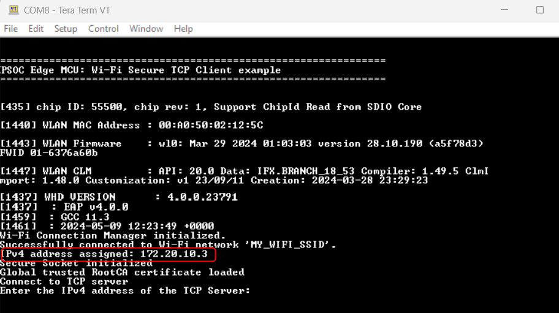
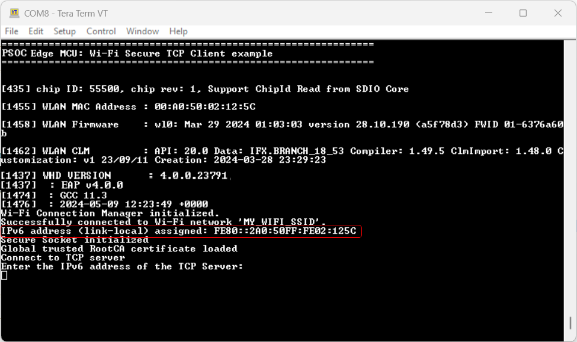
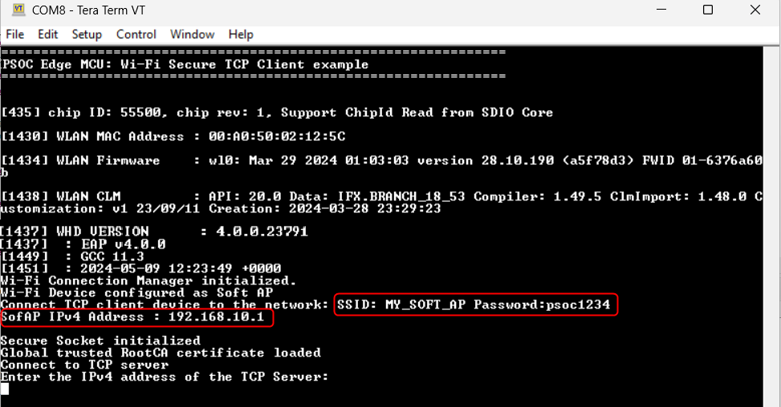
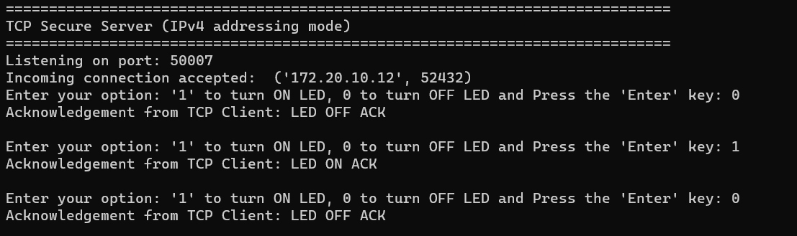
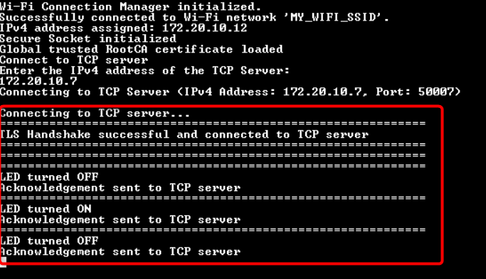
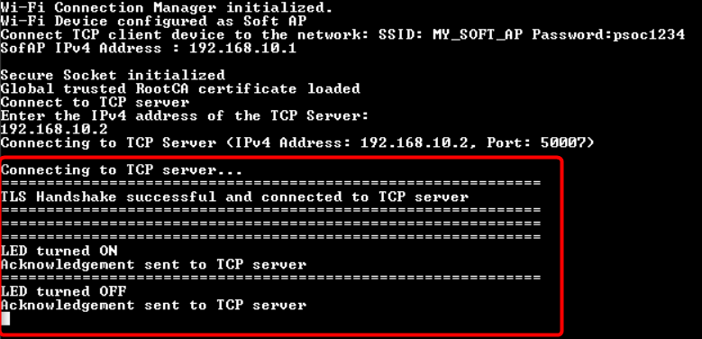
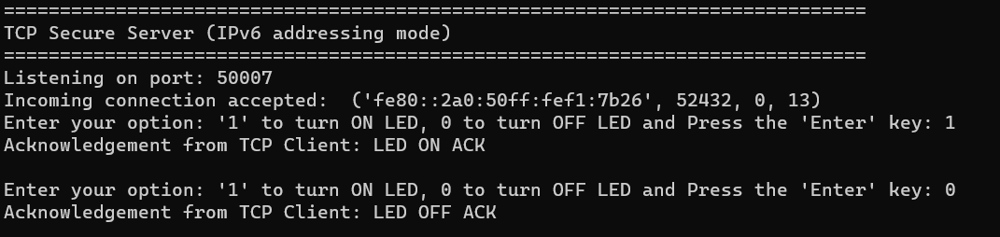
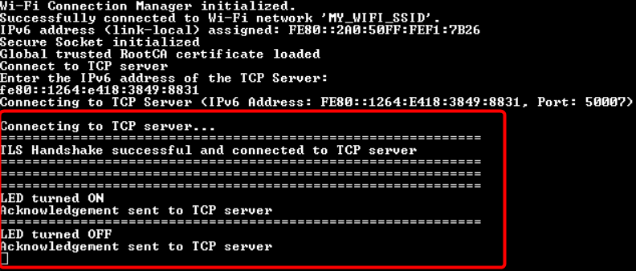

# PSOC&trade; Edge MCU: Wi-Fi secure TCP client

This code example demonstrates the implementation of a secure TCP client with Infineon's PSOC&trade; Edge E84 MCU and AIROC&trade; CYW55513/CYW55512 Wi-Fi & Bluetooth&reg; combo chip.

In this example, the TCP client establishes a secure connection with a TCP server through SSL handshake. Once the SSL handshake completes successfully, the TCP client turns the user LED on or off based on the command received from the TCP server. The Wi-Fi device can be brought up in either STA (station) interface or softAP (access point) interface mode. This example can be configured to work with IPv4 or link-local IPv6 addressing mode.
 
This example uses the Wi-Fi Core FreeRTOS lwIP Mbed TLS library of the SDK. This library enables application development based on Wi-Fi, by pulling wifi-connection-manager, FreeRTOS, lwIP, Mbed TLS, secure sockets, and other dependent modules. The secure sockets library provides an easy-to-use API by abstracting the network stack (lwIP) and the security stack (Mbed TLS).

This code example has a three project structure: CM33 secure, CM33 non-secure, and CM55 projects. All three projects are programmed to the external QSPI flash and executed in Execute in Place (XIP) mode. Extended boot launches the CM33 secure project from a fixed location in the external flash, which then configures the protection settings and launches the CM33 non-secure application. Additionally, CM33 non-secure application enables CM55 CPU and launches the CM55 application.
> **Note:** On the KIT_PSE84_HMI, all three projects are programmed to the external OSPI flash instead of QSPI.

[View this README on GitHub.](https://github.com/Infineon/mtb-example-psoc-edge-wifi-secure-tcp-client)

[Provide feedback on this code example.](https://yourvoice.infineon.com/jfe/form/SV_1NTns53sK2yiljn?Q_EED=eyJVbmlxdWUgRG9jIElkIjoiQ0UyMzk1MTkiLCJTcGVjIE51bWJlciI6IjAwMi0zOTUxOSIsIkRvYyBUaXRsZSI6IlBTT0MmdHJhZGU7IEVkZ2UgTUNVOiBXaS1GaSBzZWN1cmUgVENQIGNsaWVudCIsInJpZCI6ImFydmluZGt1bWFyLnN1cmVzaGt1bWFyQGluZmluZW9uLmNvbSIsIkRvYyB2ZXJzaW9uIjoiMi4yLjAiLCJEb2MgTGFuZ3VhZ2UiOiJFbmdsaXNoIiwiRG9jIERpdmlzaW9uIjoiTUNEIiwiRG9jIEJVIjoiSUNXIiwiRG9jIEZhbWlseSI6IlBTT0MifQ==)

See the [Design and implementation](docs/design_and_implementation.md) for the functional description of this code example.


## Requirements

- [ModusToolbox&trade;](https://www.infineon.com/modustoolbox) v3.7 or later (tested with v3.9)
- Board support package (BSP) minimum required version: 1.0.0
- Programming language: C
- Associated parts: All [PSOC&trade; Edge MCU](https://www.infineon.com/products/microcontroller/32-bit-psoc-arm-cortex/32-bit-psoc-edge-arm) parts


## Supported toolchains (make variable 'TOOLCHAIN')

- GNU Arm&reg; Embedded Compiler v14.2.1 (`GCC_ARM`) – Default value of `TOOLCHAIN`
- Arm&reg; Compiler v6.22 (`ARM`)
- IAR C/C++ Compiler v9.70.4 (`IAR`)
- Arm&reg; Toolchain for Embedded v22.1 (`LLVM_ARM`)


## Supported kits (make variable 'TARGET')

- [PSOC&trade; Edge E84 Evaluation Kit](https://www.infineon.com/KIT_PSE84_EVAL) (`KIT_PSE84_EVAL_EPC2`) – Default value of `TARGET`
- [PSOC&trade; Edge E84 Evaluation Kit](https://www.infineon.com/KIT_PSE84_EVAL) (`KIT_PSE84_EVAL_EPC4`)
- [PSOC&trade; Edge E84 AI Kit](https://www.infineon.com/KIT_PSE84_AI) (`KIT_PSE84_AI`)
- [PSOC&trade; Edge E84 HMI Kit](https://www.infineon.com/KIT_PSE84_HMI) (`KIT_PSE84_HMI`)
- [PSOC&trade; Edge E846 Evaluation Kit](https://www.infineon.com/KIT_PSE846_EVAL) (`KIT_PSE846_EVAL_EPC2`)


## Hardware setup

This example uses the board's default configuration. See the kit user guide to ensure that the board is configured correctly.

Ensure the following jumper and pin configuration on the board.
- BOOT SW must be in the HIGH/ON position
- J20 and J21 must be in the tristate/not connected (NC) position (for the PSOC&trade; Edge E84 Evaluation Kit)
- All SW8 DIP switches in OFF position (for the PSOC&trade; Edge E846 Evaluation Kit)

> **Note:** This hardware setup is not required for KIT_PSE84_AI.

## Software setup

See the [ModusToolbox&trade; tools package installation guide](https://www.infineon.com/ModusToolboxInstallguide) for information about installing and configuring the tools package.

**Python:** Download Python v 3.8-3.12 from the official [Python](https://www.python.org). After installation, add the Python directory to your system path environment variables. This lets you easily run Python commands from anywhere in your terminal.

Install a terminal emulator if you do not have one. Instructions in this document use [Tera Term](https://teratermproject.github.io/index-en.html).

This example requires no additional software or tools.


## Operation

See [Using the code example](docs/using_the_code_example.md) for instructions on creating a project, opening it in various supported IDEs, and performing tasks, such as building, programming, and debugging the application within the respective IDEs.

1. Connect the board to your PC using the provided USB cable through the KitProg3 USB connector

2. Configure the kit to run either in Wi-Fi STA or AP interface mode using the `USE_AP_INTERFACE` macro defined in the *network_credentials.h* file. Follow the steps for the desire interface mode:

   - **STA mode (default interface):**

      1. Set the `USE_AP_INTERFACE` macro to **0**; this is the default mode

      2. Modify the `WIFI_SSID`, `WIFI_PASSWORD`, and `WIFI_SECURITY_TYPE` macros to match that of the Wi-Fi network credentials you want to connect. These macros are defined in the *network_credentials.h* file. Ensure the Wi-Fi network that you are connecting to is configured as a private network for the proper functioning of this example

   - **AP mode:**

      1. Set the `USE_AP_INTERFACE` macro to **1**

      2. Update `SOFTAP_SSID`, `SOFTAP_PASSWORD`, and `SOFTAP_SECURITY_TYPE` as desired. This step is optional

3. Configure the IP addressing mode. By default, IPv4-based addressing is used. To use IPv6 addressing mode, set the `USE_IPV6_ADDRESS` macro defined in the *secure_tcp_client.h* file as follows:

   ```
   #define USE_IPV6_ADDRESS				      (1)
   ```

4. Open a terminal program and select the KitProg3 COM port. Set the serial port parameters to 8N1 and 115200 baud

5. After programming, the application starts automatically. Confirm that the text shown in any of the following figures is displayed on the UART terminal. Note that the assigned Wi-Fi SSID and IP address will be different based on the network that you have connected to; in AP mode, the AP credentials will be different based on your configuration in **Step 2**. <br> 

   **Figure 1** shows the Wi-Fi connection status in STA mode using IPv4 address. 

   **Figure 1. UART terminal showing the Wi-Fi connection status (IPv4 address and STA mode)**

   

   <br>

   **Figure 2** shows Wi-Fi connection status in STA mode using IPv6 address.

   **Figure 2. UART terminal showing the Wi-Fi connection status (IPv6 address and STA mode)**

   

   <br>

   **Figure 3** shows Wi-Fi connection status in AP mode using IPv4 address.

   **Figure 3. UART terminal showing the Wi-Fi connection status (IPv4 address and AP mode)**

   

   Similarly, when the CE is configured for IPv6 and AP mode, the IPv4 address displayed in **Figure 3** will be replaced by the IPv6 address.

6. Connect your PC to the Wi-Fi AP that you have configured in **Step 2**:

   - **In STA mode:** Connect the computer to the same AP to which the kit is connected

   - **In AP mode:** Connect the computer to the kit's AP

   Make a note of the IP address assigned to the kit. Note that the type of IP address (IPv4 or IPv6) assigned is based on the IP addressing mode configured in **Step 3**

7. Determine the computer's IP address

   To determine the IP address, type the following command in the command shell based on your operating system:

   - Windows: `ipconfig`

   - Linux: `curl ifconfig.me`

   - macOS: `ifconfig |grep inet`

8. Ensure the Python interpreter (see [Software setup](#software-setup)) is installed on your computer.

9. Open a command shell from the project directory and run the Python TCP secure server (*{project directory}\python-secure-tcp-server*).

10. In the command shell opened in the project directory, type the following command based on the IP addressing mode configuration:

   - **For IPv4-based addressing:**

      ```
     python tcp_secure_server.py
      ```

   - **For link-local IPv6-based addressing:**

      ```
     python tcp_secure_server.py ipv6
      ```

      > **Note:** Ensure that the firewall settings of your computer allow Python access to communicate with the TCP client. For more details on enabling Python access, see this [community thread](https://community.infineon.com/thread/53662)

11. In the terminal program, enter the IP address determined in **Step 7**

12. From the Python secure TCP server, send the command to turn the LED on or off to the TCP client ('0' to turn the USER_LED1 OFF and '1' to turn the LED ON). Observe the USER_LED1 (CYBSP_USER_LED) turning ON/OFF on the board. <br/>

      **Figure 4** shows the LED status on TCP server which is run using python script using IPv4 address.  

      **Figure 4. LED status on TCP server (IPv4 addressing mode) - using Python script**

      

      **Figure 5** shows the LED status on TCP client using STA mode and IPv4 address.

      **Figure 5. LED status on TCP client (IPv4 addressing and STA mode)**

      

      **Figure 6** shows the LED status on TCP client using AP mode and IPv4 address.

      **Figure 6. LED status on TCP client (IPv4 addressing and AP mode)**

      

      **Figure 7** shows the LED status on TCP server which is run using python script using IPV6 address.

      **Figure 7. LED status on TCP server (IPv6 addressing mode) - using Python script**

      

      Figure 8 shows LED status on TCP client using STA mode and IPV6 address.

      **Figure 8. LED status on TCP client (IPv6 addressing and STA mode)**

      
      
      Similarly, when the CE is configured in AP and IPv6 mode, the only difference from **Figure 6** is the IPv6 address being displayed instead of IPv4.

      > **Note:** Instead of using the Python TCP server (*tcp_secure_server.py*), you can alternatively use the 'mtb-example-wifi-psoc-edge-secure-tcp-server' example to run as the TCP server on the second kit. See the code example documentation to learn how to use the example. If you are using this example as the server, the IP address (`TCP_SERVER_IP_ADDRESS`) assigned in **Step 5** in the [Operation](#operation) section should be that of the IP address assigned to the kit in the example. When using two devices, they will be assigned the same MAC address by default, preventing them from connecting to the same Wi-Fi network. To resolve this, update the NVRAM_GENERATED_MAC_ADDRESS value in the generated_mac_address.txt file located in WHD to assign a unique MAC address to each device.


### Wi-Fi throughput

This code example is configured to run on CM33 core at a frequency of 200 MHz, out of the external flash memory. However, this setup may result in lower throughput compared to when running the code in internal memory (SRAM).

For optimal performance, it is recommended to run the code example on the CM55 core at 400 MHz, leveraging the internal memory (i.e. System SRAM/SoCMEM). For guidance on achieving better throughput, See the README file of the Wi-Fi Bluetooth tester (mtb-psoc-edge-wifi-bluetooth-tester) application.


### Creating a self-signed SSL certificate

The TCP client demonstrated in this example uses a self-signed SSL certificate. This requires **OpenSSL**, already preloaded with ModusToolbox&trade; installation. Self-signed SSL certificate means there is no third-party certificate-issuing authority (CA), involved in client authentication. Servers connecting to the this client must have an exact copy of the SSL certificate to verify the client's identity.

Perform the following to generate a self-signed SSL certificate:


#### **Generate SSL certificate and private key**

1. Run the following command within a CLI (on Windows, use the command line "modus-shell" program provided in the ModusToolbox&trade; installation instead of a standard Windows command line application) to generate the CA certificate. Follow the instructions in the command window to provide the details required
   ```
   openssl ecparam -name prime256v1 -genkey -noout -out root_ca.key
   openssl req -new -x509 -sha256 -key root_ca.key -out root_ca.crt -days 1000
   ```

2. Generate the client key pair and client certificate (signed using the CA certificate from Step 1). Follow the instructions in the command window to provide the details required

   ```
   openssl ecparam -name prime256v1 -genkey -noout -out client.key
   openssl req -new -sha256 -key client.key -out client.csr
   openssl x509 -req -in client.csr -CA root_ca.crt -CAkey root_ca.key -CAcreateserial -out client.crt -days 1000 -sha256
   ```

3. Follow the instructions in the command window to provide the details required for creating the SSL certificate and private key

   The *client.crt* file is your client's certificate and *client.key* is your client's private key


## Related resources

Resources  | Links
-----------|----------------------------------
Application notes  | [AN235935](https://www.infineon.com/AN235935) – Getting started with PSOC&trade; Edge E8 MCU on ModusToolbox&trade; software <br> [AN236697](https://www.infineon.com/AN236697) – Getting started with PSOC&trade; MCU and AIROC&trade; Connectivity devices 
Code examples  | [Using ModusToolbox&trade;](https://github.com/Infineon/Code-Examples-for-ModusToolbox-Software) on GitHub
Device documentation | [PSOC&trade; Edge MCU datasheets](https://www.infineon.com/products/microcontroller/32-bit-psoc-arm-cortex/32-bit-psoc-edge-arm#documents) <br> [PSOC&trade; Edge MCU reference manuals](https://www.infineon.com/products/microcontroller/32-bit-psoc-arm-cortex/32-bit-psoc-edge-arm#documents)
Development kits | Select your kits from the [Evaluation board finder](https://www.infineon.com/cms/en/design-support/finder-selection-tools/product-finder/evaluation-board)
Libraries  | [mtb-dsl-pse8xxgp](https://github.com/Infineon/mtb-dsl-pse8xxgp) – Device support library for PSE8XXGP <br> [mtb-dsl-pse8x6](https://github.com/Infineon/mtb-dsl-pse8x6) – Device support library for PSE8X6 <br> [retarget-io](https://github.com/Infineon/retarget-io) – Utility library to retarget STDIO messages to a UART port <br> [wifi-core-freertos-lwip-mbedtls](https://github.com/Infineon/wifi-core-freertos-lwip-mbedtls) -This repo includes core components needed for Wi-Fi connectivity support. The library bundles FreeRTOS, lwIP TCP/IP stack, Mbed TLS for security, Wi-Fi host driver (WHD), Wi-Fi Connection Manager (WCM), secure sockets, connectivity utilities, and configuration files
Tools  | [ModusToolbox&trade;](https://www.infineon.com/modustoolbox) – ModusToolbox&trade; software is a collection of easy-to-use libraries and tools enabling rapid development with Infineon MCUs for applications ranging from wireless and cloud-connected systems, edge AI/ML, embedded sense and control, to wired USB connectivity using PSOC&trade; Industrial/IoT MCUs, AIROC&trade; Wi-Fi and Bluetooth&reg; connectivity devices, XMC&trade; Industrial MCUs, and EZ-USB&trade;/EZ-PD&trade; wired connectivity controllers. ModusToolbox&trade; incorporates a comprehensive set of BSPs, HAL, libraries, configuration tools, and provides support for industry-standard IDEs to fast-track your embedded application development

<br>


## Other resources

Infineon provides a wealth of data at [www.infineon.com](https://www.infineon.com) to help you select the right device, and quickly and effectively integrate it into your design.


## Document history

Document title: *CE239519* – *PSOC&trade; Edge MCU: Wi-Fi secure TCP client*

 Version | Description of change
 ------- | ---------------------
 1.x.0   | New code example <br> Early access release
 2.0.0   | GitHub release
 2.1.0   | Added support for KIT_PSE84_HMI
 2.2.0   | Updated to support wifi-core-freertos-lwip-mbedtls v4.X <br> Added support for KIT_PSE846_EVAL_EPC2
<br>


All referenced product or service names and trademarks are the property of their respective owners.

The Bluetooth&reg; word mark and logos are registered trademarks owned by Bluetooth SIG, Inc., and any use of such marks by Infineon is under license.

PSOC&trade;, formerly known as PSoC&trade;, is a trademark of Infineon Technologies. Any references to PSoC&trade; in this document or others shall be deemed to refer to PSOC&trade;.

---------------------------------------------------------

(c) 2023-2026, Infineon Technologies AG, or an affiliate of Infineon Technologies AG. All rights reserved.
This software, associated documentation and materials ("Software") is owned by Infineon Technologies AG or one of its affiliates ("Infineon") and is protected by and subject to worldwide patent protection, worldwide copyright laws, and international treaty provisions. Therefore, you may use this Software only as provided in the license agreement accompanying the software package from which you obtained this Software. If no license agreement applies, then any use, reproduction, modification, translation, or compilation of this Software is prohibited without the express written permission of Infineon.
<br>
Disclaimer: UNLESS OTHERWISE EXPRESSLY AGREED WITH INFINEON, THIS SOFTWARE IS PROVIDED AS-IS, WITH NO WARRANTY OF ANY KIND, EXPRESS OR IMPLIED, INCLUDING, BUT NOT LIMITED TO, ALL WARRANTIES OF NON-INFRINGEMENT OF THIRD-PARTY RIGHTS AND IMPLIED WARRANTIES SUCH AS WARRANTIES OF FITNESS FOR A SPECIFIC USE/PURPOSE OR MERCHANTABILITY. Infineon reserves the right to make changes to the Software without notice. You are responsible for properly designing, programming, and testing the functionality and safety of your intended application of the Software, as well as complying with any legal requirements related to its use. Infineon does not guarantee that the Software will be free from intrusion, data theft or loss, or other breaches (“Security Breaches”), and Infineon shall have no liability arising out of any Security Breaches. Unless otherwise explicitly approved by Infineon, the Software may not be used in any application where a failure of the Product or any consequences of the use thereof can reasonably be expected to result in personal injury.